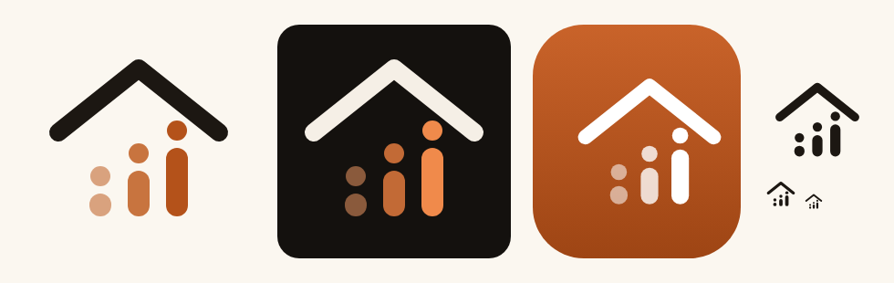

# Logo (sans nom)

Symbole seul, sans texte : utilisable quel que soit le nom final de l'app.

## Concept

- **Le toit** : le grenier, l'abri commun du quartier.
- **Trois familles** (tête ronde + corps arrondi) de plus en plus grandes : plus on est nombreux, plus on monte les paliers de prix.
- Le dégradé de couleur va du clair au plus intense : la famille qui rejoint fait baisser le prix pour tout le monde.

## Fichiers

| Fichier | Usage |
|---|---|
| `logo-app-icon.svg` / `.png` (1024 px) | Icône de l'app (`AppIcon.appiconset`), écran de lancement |
| `logo-mark.svg` / `.png` | Symbole sur fond clair (Fond `#FBF7F0`) |
| `logo-mark-dark.svg` / `.png` | Symbole sur fond sombre (`#14110E`) |
| `logo-mono.svg` / `.png` | Une couleur, Texte `#1C1712` (impression, petites tailles) |
| `logo-mono-white.svg` | Une couleur, blanc, sur photo ou fond Accent |

## Couleurs (tokens de `DESIGN-SYSTEM.md`)

- Clair : toit Texte `#1C1712`, familles `#D9A27E` → `#C8743F` → Accent `#B4521A`.
- Sombre : toit `#F5EFE6`, familles `#8A5A3C` → `#C26A36` → Accent `#F08A4B`.
- Icône : dégradé `#C9632A` → `#9E4514`, symbole blanc (familles à 55 %, 80 %, 100 %).

## Règles

- Garder une marge vide d'au moins 1/8 de la largeur autour du symbole.
- Taille minimale : 20 pt (en dessous, utiliser `logo-mono`).
- Ne pas déformer, ne pas ajouter d'ombre ni de contour, ne pas changer l'ordre des familles.
